# 红果桌面版

**找剧 · 双端同步 · 评论互动 · 插帧超分 · 音质增强 · 自定义桌面**

Windows 10/11 x64 · 便携版 · 解压即用

**[下载最新版本](https://github.com/cc652464876/hongguo-desktop/releases/latest)** · [全部版本](https://github.com/cc652464876/hongguo-desktop/releases) · [问题反馈](https://github.com/cc652464876/hongguo-desktop-feedback/issues)

## 功能：找剧、追剧、互动，一站完成

- **双端同步**：登录同一红果账号，同步观看历史、播放进度、收藏与点赞；手机看过，电脑接着看。
- **找剧与推荐**：剧名 / 演员搜索、题材筛选、排行榜、上新日历；支持真人剧、漫剧、AI 剧等分类。
- **评论与弹幕**：查看、发布、回复评论；发送弹幕、评论点赞、弹幕点赞；弹幕字号、行数、透明度可调。
- **收藏与点赞**：收藏剧集、点赞视频，集中查看个人收藏、点赞与历史记录。
- **追更与预约**：追更剧集、预约新剧，接收更新与上线提醒；查看演员 / 出品方主页及作品，支持关注。
- **独立播放器**：播放与浏览分窗；选集、倍速、画质切换、连续播放、断点续播、全屏、置顶、窗口吸附。
- **本地与下载**：批量下载、离线观看、直接打开本地视频、添加片库文件夹、最近播放与进度记忆。
- **快捷操作**：自定义快捷键、互动按钮显隐、清屏、窗口锁定、摸鱼隐藏、复制分享链接。

> 双端同步需登录同一账号并开启「启用账号」；同步与互动以账号权限及上游接口实际返回为准。

<table>
<tr>
<td width="50%">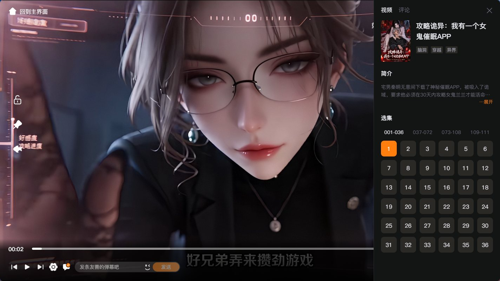 <b>独立播放 · 同屏选集</b></td>
<td width="50%">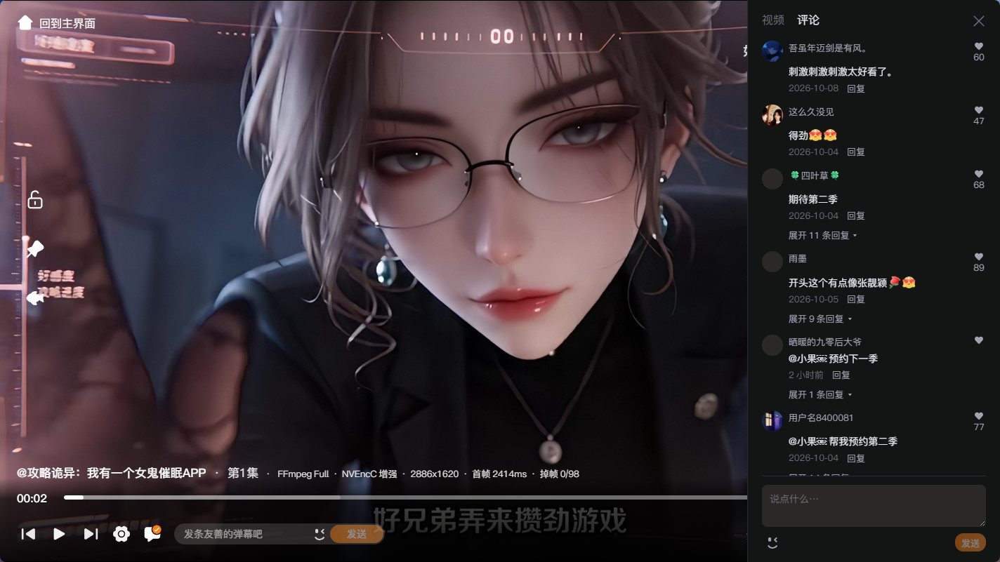 <b>评论互动 · 边看边聊</b></td>
</tr>
<tr>
<td width="50%"> <b>搜索筛选 · 按喜好找剧</b></td>
<td width="50%">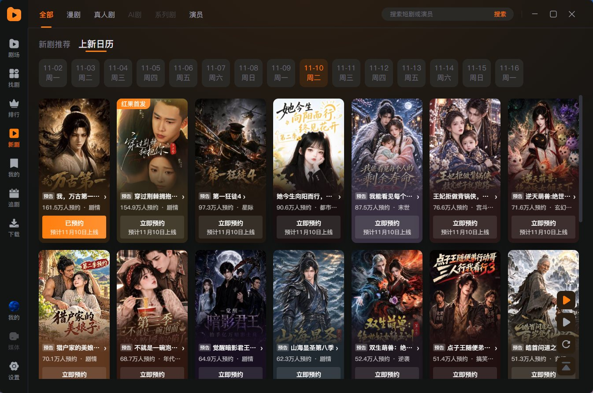 <b>上新日历 · 预约追更</b></td>
</tr>
</table>

## 影音：画面更清晰，运动更流畅，对白更好听

### 两项 NVIDIA 技术

- **NVIDIA 光流插帧（FRUC）**：生成中间帧，输出双倍帧率，例如 30 → 60 fps；改善运动流畅度。
- **NVIDIA RTX 视频超分辨率（VSR）**：AI 放大视频、改善细节；提供 **1～4 档**，档位越高，显卡负载通常越大。

> **显卡支持要求**：FRUC 需要支持 NVIDIA 光流的 Turing 或更新架构显卡；VSR 需要受支持的 NVIDIA RTX 显卡（RTX 20 系列及更新型号）。两项功能均需兼容驱动、运行库及足够的 GPU 性能，AMD / Intel 显卡不能使用这两项 NVIDIA 增强。
>
> **使用方法**：播放器设置选择 **FFmpeg → 确认**，再开启「视频插帧」或「视频超分」。本程序插帧适用于像素量不超过 1920×1080、原始帧率低于 60 fps 的片源；具体可用性以面板提示为准。
>
> **出现卡顿、丢帧、黑屏或无法播放时，请主动关闭插帧和超分，并降低其他增强设置。** 普通播放、一般画面处理与音频增强不要求 NVIDIA 显卡。

驱动参考：FRUC ≥ 528.24，VSR ≥ 550.58；建议使用稳定版新驱动。硬件与驱动要求见 <a href="https://github.com/rigaya/NVEnc/blob/9.40/NVEncC_Options.en.md">NVEncC 9.40 文档</a>。实时效果取决于片源与显卡性能。

### 画面处理

- **Anime4K 动画修复**：画面修复 / 柔和修复 / 保真放大 **3 种模式**，速度优先 / 画质优先 **2 档策略**。
- **3 种锐化算法**：Unsharp、CAS、OpenCL Unsharp，按片源与性能选择。
- **画面清理与质感**：消除色带、去压缩块、胶片颗粒、胶片质感；质感强度 **0～30** 可调。
- **显示适配**：去黑边、填充画面、原始比例与全屏显示。

### 音质增强

- **响度均衡**：减轻片段间忽大忽小的音量差异。
- **对话增强**：突出对白清晰度，使用双声道输出。
- **3 种均衡预设**：低音增强、人声增强、高音增强；也可关闭，保留原声。
- **音轨与声道**：切换可用音轨；默认音道 / 双声道 / 单声道立体声处理。

### 解码与兼容

- **3 类可选解码程序**：Electron 内置、FFmpeg Full、WASM；另有自动选择。
- **GPU 硬解 / CPU 软解 / 自动解码**：按设备与片源选择；WASM 仅 CPU。
- **FFmpeg Full**：随包提供完整解码与滤镜组件，支持 H.264、HEVC 等常见编码及本地视频；另含 **ByteVC2 专用软件解码**。
- **自动恢复**：不兼容的增强或解码组合可尝试降级，成功出画后保存可用设置；播放器显示实际解码方式与掉帧信息。

<table>
<tr>
<td width="50%">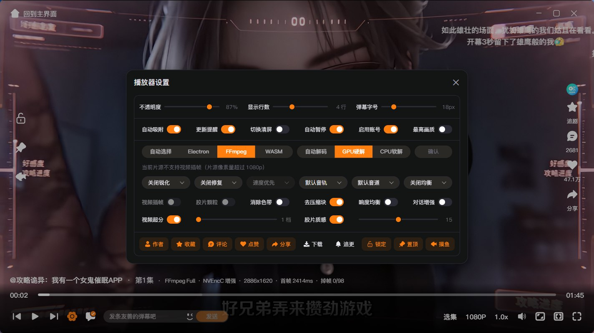 <b>解码 · 插帧 · 超分 · 音频增强</b></td>
<td width="50%">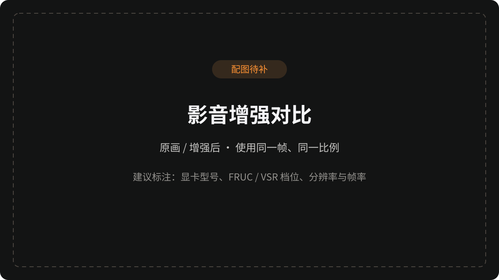 <b>增强前后对比（配图待补）</b></td>
</tr>
</table>

## 外观：21 个主题、9 种动效，DIY 你的追剧桌面

### 21 个内置主题 · 42 组深浅配色

**浅色 / 深色 / 跟随系统**，每个主题均提供深浅两套配色。

- **默认、绯霞、暖砂、绝对、Ayu、猫布奇诺、德古拉**
- **常青森林、GitHub、Gruvbox、Linear、龙虾、东京之夜、材质**
- **Monokai、北欧、Notion、一、玫瑰松、日光、Codex**

### 9 种动态背景特效

**星空穿梭 · 圆圈粒子 · 群鸟飞翔 · 蝴蝶飞舞 · 烟花绽放 · 鼠标流体 · 粒子海浪 · 车流光轨 · 数字火焰**

- **按需选用**：一次开启一种动效，可随时关闭。
- **动效调节**：支持透明度、速度等参数；鼠标流体使用自身交互规则。
- **专属参数**：粒子海浪 **4 档浪况**，车流光轨 **6 档曝光**，数字火焰可调燃烧量。

### 不止换肤，还能自由搭配

- **自定义颜色**：独立调整主色、背景色、文字色；支持色值输入、选色面板、屏幕吸色。
- **自定义壁纸**：使用本地图片作为程序背景，调整图片透明度与背景颜色。
- **自定义字体与图标**：分别选择常规 / 粗体字体，替换程序图标；默认图标随主题变色。
- **统一界面**：主窗口、独立播放器及选集、评论、菜单跟随主题；主题与深浅模式分别保存自定义颜色。

<table>
<tr>
<td width="50%">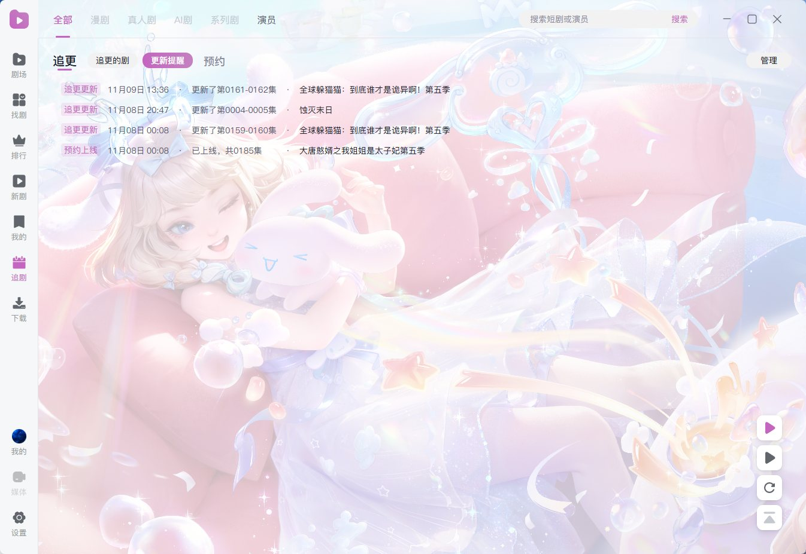 <b>浅色主题 + 自定义壁纸</b></td>
<td width="50%">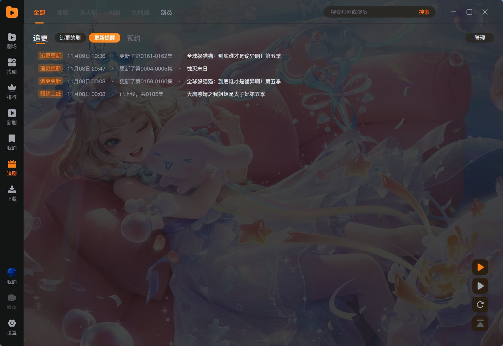 <b>深色主题 + 自定义壁纸</b></td>
</tr>
<tr>
<td width="50%">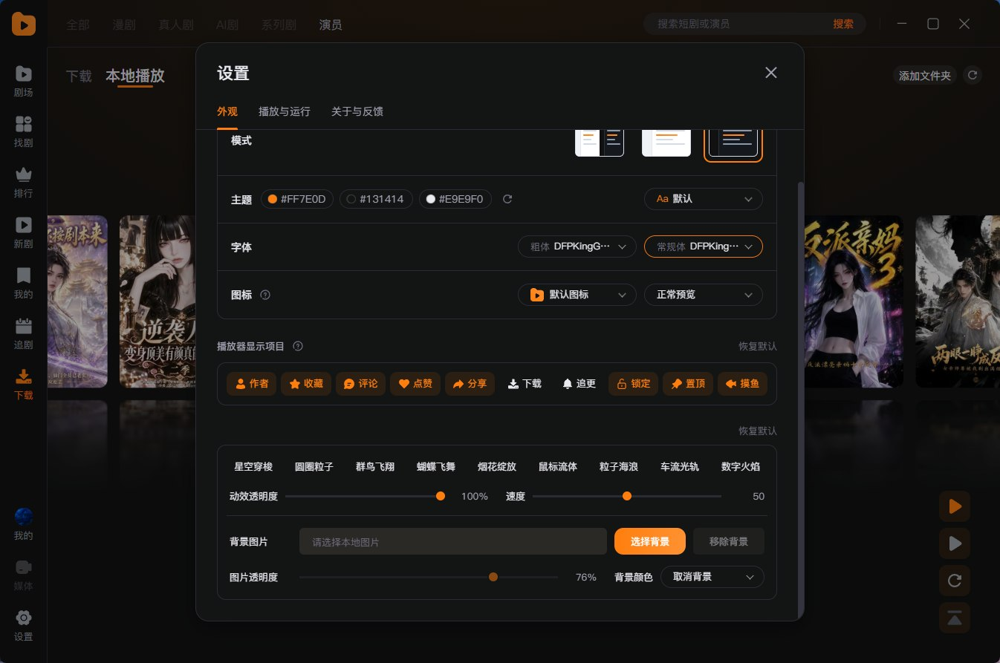 <b>配色 · 字体 · 图标 · 壁纸 · 动效</b></td>
<td width="50%">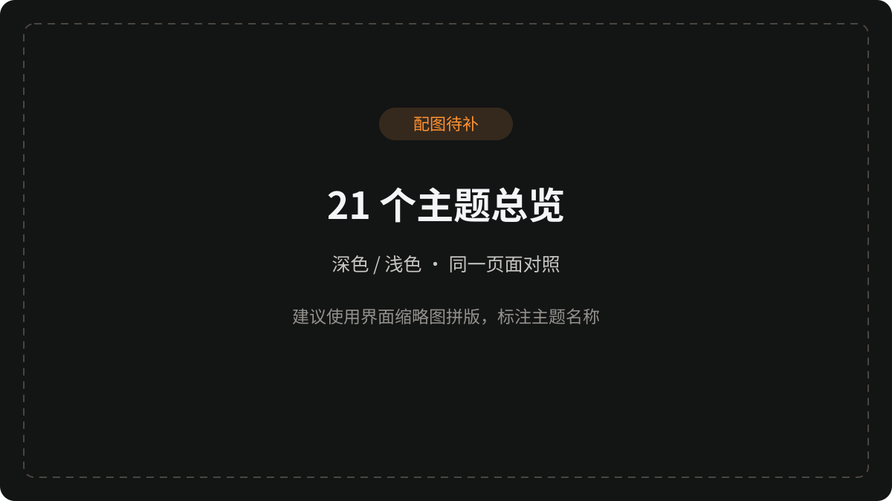 <b>21 主题总览（配图待补）</b></td>
</tr>
<tr>
<td colspan="2"> <b>9 种动态背景特效（配图待补）</b></td>
</tr>
</table>

更多界面：弹幕、排行榜、本地片库、剧集详情

<table>
<tr>
<td width="50%"> <b>弹幕与播放控制</b></td>
<td width="50%">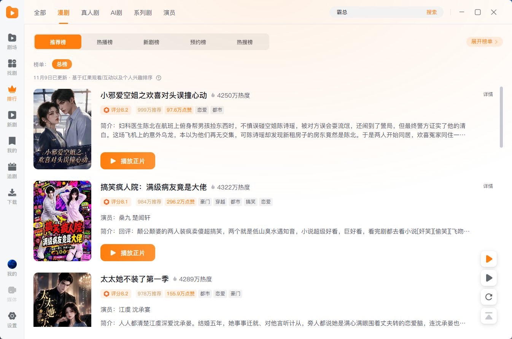 <b>排行榜</b></td>
</tr>
<tr>
<td width="50%">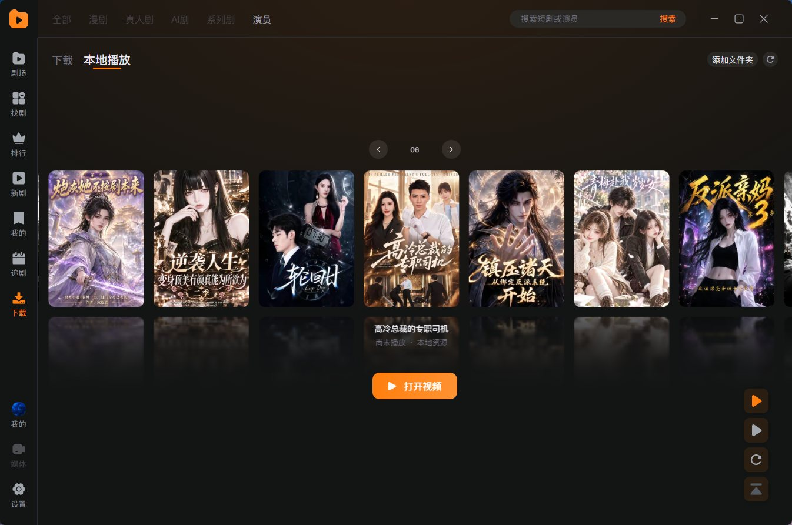 <b>本地片库 · 最近播放</b></td>
<td width="50%">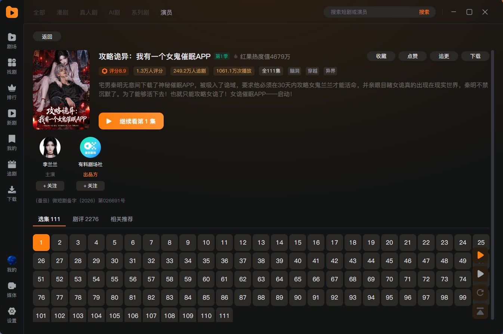 <b>剧集详情 · 演员 · 选集</b></td>
</tr>
</table>

## 下载与运行

1. [下载 Windows x64 ZIP](https://github.com/cc652464876/hongguo-desktop/releases/latest)，完整解压到可写位置。
2. 双击 `红果桌面版.exe`。保留整个文件夹，不要单独移动 EXE 或在压缩包内运行。
3. 按需登录；找剧与在线播放需联网，已下载视频可离线观看。

- **运行组件已内置**：无需另装 Python、Node.js 或 FFmpeg。
- **默认数据**：程序目录下 `用户数据`；机型数据保存在 `.device-profiles` 子目录。
- **默认下载**：`用户数据/downloads`，可在设置中更改。
- **干净发布包**：不包含已有账号、设备身份、观看记录、缓存或调试日志。
- **完整性检查**：Release 附带 `.sha256`；解压后可运行 `环境检查.cmd`。
- **反馈**：「设置 → 关于与反馈」，或前往 [问题反馈仓库](https://github.com/cc652464876/hongguo-desktop-feedback/issues)。
- **第三方许可**：随程序包保留在各组件目录中。
